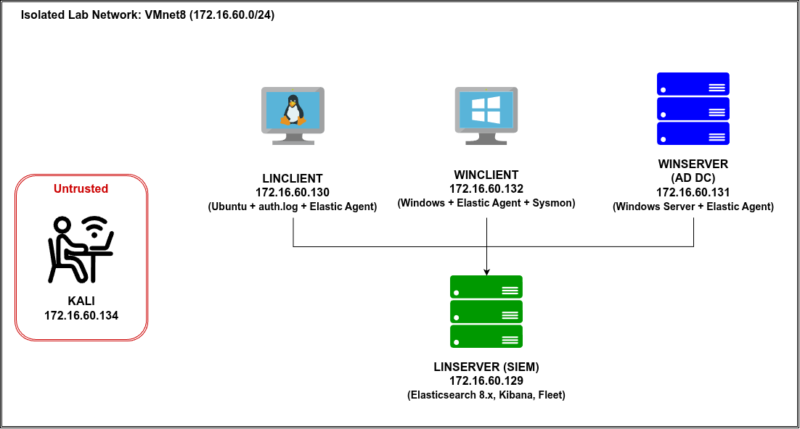

# Blueteam SIEM Lab

**A self-built Elastic SIEM detecting and triaging real attacks across a five-machines lab, with full incident reports and detection-gap analysis.**

## Overview

This repository is the SIEM and incident-response component of a larger home-lab project. 

- Standing up a centralized SIEM across a small Windows/Linux/AD environment
- Writing and tuning six custom detections mapped to MITRE ATT&CK
- Safely attacking the lab to generate real detection data, and producing full incident reports from it
- Reports built and written from this lab's own alerts, logs, and screenshots.

## Skills demonstrated

| Area                                                    | Where to look                               |
| ------------------------------------------------------- | ------------------------------------------- |
| SIEM engineering (Elastic Stack, Fleet, agent policies) | `architecture/`, Architecture section below |
| Detection engineering & MITRE ATT&CK mapping            | `detection-rules/`                          |
| Incident response & formal report writing               | `incident-reports/`                         |
| Attack emulation (Hydra, Nmap, PowerShell)              | `detection-rules/README.md`                 |
| Linux system hardening & auditing (auditd, SSH)         | In below at Detection Gaps Section          |
| Practical Self-assessment of detection coverage         | In below at Detection Gaps Section          |

## Architecture

- Five VMs on one isolated, host-only `172.16.60.0/24` vmnet1 network with no route to the home LAN. 
- All machines except Kali are part of the Elastic Fleet through the SIEM (Linserver).



**Telemetry pipeline:** every endpoint runs Elastic Agent, managed centrally through the Linserver Fleet, under two policies:
- **Windows Policy:** Windows integration (Sysmon Operational, PowerShell Operational, Security) + System integration.
- **Linux Policy:** System integration (auth.log, syslog) + Auditd Manager

## Tech stack

| Layer              | Tooling                                                                                                    |
| ------------------ | ---------------------------------------------------------------------------------------------------------- |
| SIEM               | Elastic Stack 8.19.x (Elasticsearch, Kibana, Fleet Server)                                                 |
| Endpoint telemetry | Sysmon (SwiftOnSecurity configuration), Windows Security Auditing, PowerShell Script Block Logging, auditd |
| Attack emulation   | Hydra, Nmap, PowerShell                                                                                    |
| Directory services | Active Directory Domain Services, DNS, Group Policy                                                        |
| Response tooling   | Windows Firewall, native iptables/auditd                                                                   |

## Detection coverage (MITRE ATT&CK)

Six custom detections, exported as NDJSON rules in `detection-rules/`, each carried on for at least one time.

| #   | Rule file                                          | Detection                               | Tactic                        | Technique | Telemetry source                |
| --- | -------------------------------------------------- | --------------------------------------- | ----------------------------- | --------- | ------------------------------- |
| 1   | `t1059-001-encoded-powershell-execution.ndjson`    | Encoded/Obfuscated PowerShell Execution | Execution and Defense Evasion | T1059.001 | Sysmon Event ID 1               |
| 2   | `t1110-ssh-brute-force.ndjson`                     | SSH Brute Force                         | Credential Access             | T1110.001 | Linux auth.log                  |
| 3   | `t1046-aggressive-port-scan-cross-platform.ndjson` | Network Port Scanning, Cardinality      | Discovery                     | T1046     | Linux syslog, Sysmon Event ID 3 |
| 4   | `t1548-003-sudo-privilege-escalation.ndjson`       | Sudo Privilege Escalation Anomaly       | Privilege Escalation          | T1548.003 | Linux `auth.log`                |
| 5   | `t1053-005-scheduled-task-persistence.ndjson`      | Scheduled Task Persistence              | Persistence                   | T1053.005 | Sysmon Event ID 1               |
| 6   | `t1046-linux-port-scan-cardinality.ndjson`         | Network Port Scanning, Cross-Platform   | Discovery                     |           |                                 |

## Severity Scheme
| Level        | Criteria                                                                    |
| :----------- | :-------------------------------------------------------------------------- |
| **Low**      | Suspicious activity, no success, no sensitive asset compromised.            |
| **Medium**   | Attack succeeded on a non-critical host, contained successfully.            |
| **High**     | Credential access, persistence, or execution on an important host.          |
| **Critical** | Domain controller compromise, domain-wide ransomware, or data exfiltration. |

## Incident reports

Two attacks were carried through to full, formal incident reports: executive summary, timeline, technical evidence, root cause, and remediation. Each report is backed by evidence screenshots found in `incident-reports/assets/`:

- **IR-001: Encoded PowerShell Execution on WinClient.** Base64-encoded PowerShell execution detected via Sysmon. To mitigate the attack, the host was isolated at the network layer within minutes of detection.  Evidence: `alert_2.png` through `alert_2f.png`.
- **IR-002: SSH Brute Force on Linclient.** Hydra-based credential attack against a weak local account; a custom filter rule fired. To mitigate the attack, the account was locked and the source IP blocked at the host firewall. Evidence: `alert_1.png`, `alert_1b.png and alert_1c.png`.

The remaining four detections (sudo privilege escalation, scheduled task persistence, Linux cardinality port scanning, and cross-platform network port scanning) were run and validated but they were explained through summaries in the `detection-rules/README` file.

## Detection gaps & lessons learned

Every detection was pushed past the safe path in order to precisely know where it was detected.

**Sudo Privilege Escalation (T1548.003, LinClient)** 
The rule correctly fired on unauthorized `NOT in sudoers` attempts and `sudo` shell spawns (`su` and `bash`) while staying silent for the authorized administration activity through the `"*linclient*"` exclusion. However, there was a blind spot: the detection depends entirely on `syslog`/`auth.log` text ingestion. An attacker who manages to stop `rsyslog` or who can alter local log files before escalating can blind the SIEM.

**Scheduled Task Persistence (T1053.005, WinClient)**
Sysmon Event ID 1 (`schtasks.exe /create`) and Windows Security Event ID 4698 correlated cleanly, and browser update logs (`GoogleUpdate`, `Mozilla`, `OneDrive`) was tuned out appropriately. However, it does not catch persistence written directly to the Task Scheduler registry hive (TaskCache).

**Linux Network Port Scanning, Cardinality Detection (T1046, LinClient)**
The threshold rule (20+ distinct `destination.port` connections from one `source.ip` within a 2-minute lookback window) caught a standard `nmap -sS` scan cleanly via `iptables` (`NMAP_SYN_SCAN`) logs. However, it would miss slow scans (`-T1`) spread over hours. Genuine evasive scanning must not rely on a short-window log threshold and use appropriate context-behavioural rules.

**Cross-Platform Aggressive Port Scan (T1046, WinClient & LinClient)**
Combining Sysmon Event ID 3 (`NetworkConnect`) on Windows with `NMAP_SYN_SCAN` syslog events on Linux caught high-volume reconnaissance (100+ connection events within 5 minutes) across both OS. However, because Sysmon Event ID 3 counts raw socket connections rather than unique destination ports, legitimate high-connection tools (backup agents, vulnerability scanners or software updaters) can trigger false positives without explicit `process.name` or `source.ip` filters.

## Safety 

- The attacker VM and all targets sit on one isolated network with no route out.
- Every attack run follows a fixed order of operations: snapshot the target, record the exact time, run the exact documented command, confirm the telemetry landed in Kibana, then revert to the clean snapshot. This keeps every run reproducible and keeps the SIEM's data clean between tests.
- Secrets, lab passwords, Fleet enrollment tokens, encryption keys, license keys are excluded from version control. Build notes use placeholders; nothing in this repo should be read as a literal credential in current use.

## Repository layout
```
blueteam-siem-lab/
├── README.md
├── architecture/
│   └── lab-topology.png
├── detection-rules/
│   ├── t1059-001-encoded-powershell-execution.ndjson
│   ├── t1110-ssh-brute-force.ndjson
│   ├── t1046-aggressive-port-scan-cross-platform.ndjson
│   ├── t1548-003-sudo-privilege-escalation.ndjson
│   ├── t1053-005-scheduled-task-persistence.ndjson
│   └── t1046-linux-port-scan-cardinality.ndjson
└── incident-reports/
    ├── IR-001.md
    ├── IR-002.md
    └── assets/
```

## Related work (not in this repository, upcoming)

This repo covers the SIEM and incident-response piece only. Three related efforts are being built separately and are not part of this folder's deliverables:

- **Vulnerability assessment**: Nessus/OpenVAS scan of the lab hosts, remediation plan, and rescanning.
- **DevSecOps pipeline**: SAST, secrets scanning, and SCA on a seeded-vulnerable app.
- **Desktop Sentinel**: a lightweight Python monitoring agent for a personal Linux machine, kept intentionally separate from this lab SIEM.